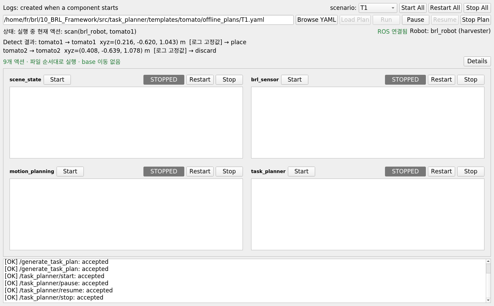

# 10_BRL_Framework

모션 플래닝 이하 최적제어 알고리즘을 연결하기 위한 ROS1/catkin 작업공간입니다.
**Task planning은 03의 offline replay, sensing·모션 동작·파라미터는 01을 기준으로 사용합니다.**
01, 03 원본 작업공간은 수정하지 않았습니다.

## 구성과 원본 기준

| 구성 | 기준 | 처리 |
| --- | --- | --- |
| `task_planner` | `03_BRL_TOMATO/src/pomdp_planner`의 offline 실행 경로 | `offline_actions`를 목록 순서대로 실행. online search·belief·질문 경로 제외 |
| `T1.yaml` | 03의 offline plan 형식 | 두 토마토 작업을 하나로 통합. Pick → scan은 개별 단계 |
| `motion_planning` | 01 | 플래너 코어, visual servoing, ROS 노드 전체를 바이트 단위로 동일하게 복사 |
| `brl_sensor` | 01 | tracker·visual servoing/scan 입력용 센서 코드와 파라미터 유지. Task의 detect는 아래 고정 로그 값을 사용 |
| `common_models`, ROS msg/srv/action | 01 | 기존 모델·필드·서비스 형식 유지 |
| `knowledge_interface` | 01의 메모리 SceneManager | 기존 `/scene_graph`와 상태 갱신 서비스 유지. 환경 JSON을 직접 읽고 메모리에서만 상태 관리 |
| navigation | placeholder | 원본 `navigate` 단계는 `prepare_nav` 팔 접기로 실행. base 이동은 구현하지 않음 |

실행 흐름은 03처럼 **task planner → ROS actionlib/service → sensing/motion**입니다.
Behavior Tree, corrective feedback, feedback manager, POMDP online planner, LLM은 실행하지 않습니다.
데스크톱 GUI는 `run_gui.sh`로 별도로 실행합니다.
`knowledge_interface`, `common_models`, `brl_interfaces`는 기존 ROS 연결을 유지하는 지원 패키지입니다.

```text
10_BRL_Framework/
├── src/
│   ├── task_planner/         # 03 offline replay + 01 연결 어댑터
│   ├── brl_sensor/           # 01 sensing
│   ├── motion_planning/      # 01 MoveIt + visual servoing
│   ├── knowledge_interface/  # 메모리 Scene Graph 상태 전달
│   ├── common_models/
│   └── brl_interfaces/
├── tools/check_framework.py  # 원본 보존·plan 검증, ROS 실행 없음
├── tools/ros_smoke_test.py   # 별도 localhost master + 가짜 센서/액션 통합 검증
├── run_gui.sh               # 데스크톱 GUI 실행
├── run_master_gui.py        # 노드 관리·offline plan 제어·상태 표시
└── SOURCE_MANIFEST.json     # 원본 경로, SHA-256, 추출한 03 함수 기록
```

## 지원 액션

03의 YAML 형식을 그대로 사용합니다. `index`는 메타데이터이고 **파일의 목록 순서**대로 실행합니다.

```yaml
offline_actions:
  - index: 1
    name: prepare_nav(brl_robot)
  - index: 2
    name: detect(brl_robot, stem_01)
  - index: 3
    name: pick(brl_robot, tomato1, stem_01)
  - index: 4
    name: scan(brl_robot, tomato1)
  - index: 5
    name: place(brl_robot, tomato1)
```

| Plan 액션 | ROS 연결 / 동작 |
| --- | --- |
| `prepare_nav(robot)` | `/{robot}/prepare_navigation` → 01의 팔 접기 모션 |
| `navigate(robot, from, to)` | 실행 시 `prepare_nav(robot)`로 변환 → 01의 팔 접기 모션. base 이동·위치 갱신 없음 |
| `detect(robot, stem)` | 카메라·YOLO·검출 서비스 호출 없이 로그의 두 고정 좌표를 메모리 Scene Graph에 등록 |
| `pick(robot, tomato, stem)` | `/{robot}/pick_tomato` → 01의 pre-pick → visual servoing → post-pick |
| `scan(robot, tomato)` | single scan 시작 서비스 → `scan_tomato` 모션 → single scan 종료 서비스 |
| `place(robot, tomato)` | 03처럼 `/place_tomato`에 `tomato_class="0"` 전달 → 01의 ripe 배치 모션 |
| `discard(robot, tomato)` | 03처럼 같은 `/place_tomato`에 `tomato_class="2"` 전달 → 01의 배출 모션 |

별도의 discard 모션을 만들지 않았습니다. 원본 01의 `place_tomato` 비정상 클래스 분기를 재사용합니다.
모든 plan에서 `pick`과 `scan`은 각각 별도 단계입니다. Pick의 완료와 `picked` 상태 갱신 후 다음 scan 단계를 실행합니다.
`offline_plans` 폴더에는 **T1.yaml 하나만** 있습니다. 기본 실행 순서는 다음과 같습니다.

```text
prepare_nav → detect
→ pick(tomato1) → scan(tomato1) → place(tomato1)
→ pick(tomato2) → scan(tomato2) → discard(tomato2)
→ prepare_nav
```

고정 `tomato1`은 place, `tomato2`는 discard로 처리합니다. 첫 단계와 마지막 단계에서 01의 팔 접기 모션을 수행합니다.

## 01 ↔ 03 연결에 필요한 변경

- Task의 `detect`는 `task_planner/config/log_detections.json`을 읽어 `tomato1`, `tomato2`를 항상 같은 좌표로 등록합니다. 카메라가 연결되지 않거나 실제 검출 결과가 없어도 두 좌표가 제공됩니다.
- `stem_01` 같은 03 plan의 위치 이름을 실제 Scene Graph의 `Stem_01`에 연결합니다.
- 기존 01 `TriggerSensorScan` 응답 형식은 유지합니다. Scan 관련 선택적 `facts` 필드만 호환 처리하고, task detect는 이 서비스를 호출하지 않습니다.
- 액션 완료 후 상태는 01 기준으로 `picked`, `scanned`, `in_basket`, 삭제를 반영합니다. 스캔 서비스 후 새 Scene Graph를 기다려 센서의 클래스가 이전 값으로 덮이지 않게 합니다.
- 03의 ROS action 메서드 12개를 추출했습니다. Scan 메서드의 `facts` 접근만 01 응답 형식에 맞췄으며, 나머지는 AST 단위로 동일합니다. Pick과 scan은 각각 기존 ROS action을 호출합니다.

모션 코어의 waypoint, quaternion, planning group, 충돌체, 보간, 이동 간격, gripper 수치와 대기 시간은 01 그대로입니다. 예를 들어 visual servoing의 bbox 기준은 **240**, 이동 간격은 **0.02 m**, 중심 범위는 x=(400,460), y=(200,260)입니다. Prepare-navigation의 관절 목표도 01의 `[1.578, -0.237, -2.746, -1.171, 1.636, -1.461]` rad를 그대로 사용합니다.

Task executor에 속하는 action 서버 연결 timeout(30초), detect settle(0.5초)은 03 offline 실행 코드의 기본값입니다. `navigate`에서 변환한 `prepare_nav`도 모션 action 서버의 완료 결과를 기다립니다.

## Detect의 고정 로그 좌표

`detect`는 실제 검출을 시도하지 않고, 매번 다음 두 값을 반환·등록하는 캐시 동작입니다.
좌표계는 01 모션과 같은 `robot_base_footprint`, 단위는 m입니다.

| 이름 | X | Y | Z | T1에서의 처리 |
| --- | --- | --- | --- | --- |
| `tomato1` | 0.216 | -0.620 | 1.043 | place |
| `tomato2` | 0.408 | -0.639 | 1.078 | discard |

두 값은 01의 `20261106_102613_661967_gui` 실행 로그에서 선택했습니다. 검출 당시 둘 다 class 0이었고, 두 위치 모두 pick 성공 기록이 있습니다. 원본 객체명과 근거 로그의 줄 번호는 `config/log_detections.json`에 기록했습니다.
Detect를 반복하면 이전 place/discard 상태와 무관하게 두 객체를 다시 `detected`, `tomato_class=0` 상태로 등록합니다. GUI에는 **로그 고정값**으로 표시합니다.

T1의 detect 단계가 두 고정 좌표를 등록합니다. Pick·visual servoing·scan의 기존 01 동작은 유지합니다.

## 데스크톱 GUI

01·03·04와 같은 기본 Qt 디자인과 2열 노드·로그 카드 배치를 사용합니다. 상단에서 10번의 offline plan과 실행 상태를 제어합니다.
기존 ROS master와 로봇 측 MoveIt·카메라·AMCL·TF를 준비한 뒤 실행합니다.

```bash
cd /home/fr/brl/10_BRL_Framework
./run_gui.sh
```

PyQt5가 없다면 Ubuntu의 `python3-pyqt5`를 설치하거나 `requirements.txt`를 사용합니다.
GUI 창은 ROS master 없이도 열리며, 노드 실행에는 빌드된 `devel/setup.bash`가 필요합니다.

1. **Start All** 또는 각 카드의 **Start / Restart / Stop**으로 메모리 상태 → 센서 → 모션 → task planner 노드를 관리합니다. 노드 준비 상태와 로그를 카드에서 확인합니다.
2. 기존 선택창에서 **T1**을 고르거나 **사용자 지정 / Browse YAML**로 파일을 지정합니다. 선택창과 경로 입력창은 실행 중에도 사용할 수 있습니다. **Details → Plan**에서 선택한 파일의 액션 순서를 확인합니다.
3. **Load Plan**은 plan만 준비합니다. **Run**은 선택된 파일을 서비스로 다시 불러온 뒤 실행합니다.
4. **Pause / Resume / Stop Plan**은 기존 `/task_planner/*` ROS 서비스를 호출합니다. 일시정지는 현재 액션이 끝난 뒤 적용되고, 작업 중지는 진행 중인 action goal을 취소합니다.

현재 액션과 planner 상태는 상단에 표시합니다. **Details → Scene**에서 기존 ROS 토픽으로 수신한 로봇 위치·보유 객체, 토마토 클래스·상태를 확인합니다. 상세 패널은 처음에는 접혀 있어 로그 공간을 넓게 사용합니다.
GUI를 여는 것만으로 노드나 plan을 실행하지 않습니다. 모션 노드를 시작하면 01의 기존 초기화와 그리퍼 초기 열기는 그대로 수행됩니다.
**Stop All**과 창 닫기는 GUI가 시작한 프로세스만 종료합니다. 외부 노드를 사용 중이면 작업 종료에는 **Stop Plan**을 사용합니다.

이미 외부에서 실행하는 노드는 중복 실행하지 않도록 해당 옵션으로 제외합니다.

```bash
# 로봇 측 motion/sensing 노드를 외부에서 실행하는 경우
./run_gui.sh --no-motion --no-sensor

# 다른 빌드 환경 또는 정적 환경 파일
./run_gui.sh --setup /path/to/devel/setup.bash \
  --environment-config /path/to/farm.json
```

추가 옵션: `--no-state`, `--no-task-planner`, `--robot-name`, `--robot-type`, `--wait-timeout`, `--log-dir`.
기본 로그 경로는 `10_BRL_Framework/logs/master_gui/<시각>_gui/`입니다.
노드별 로그와 `controls.log`에 ROS 명령 결과가 저장되며, 서비스 호출 실패는 화면에도 표시합니다.
GUI에도 Neo4j·CF·feedback manager 기능은 포함하지 않습니다.



## 빌드와 실행

ROS Noetic, 기존 MoveIt/UR5e·gripper·카메라·AMCL·TF 환경을 사용합니다.
Python 의존성은 `requirements.txt`에 기록했습니다. 기존 `ROS_MASTER_URI`, `ROS_IP`를 사용합니다.
**Neo4j 연동·드라이버·동기화·접속 설정은 제거했습니다. DB 서버나 비밀번호가 필요하지 않습니다.**
시작할 때 01의 `knowledge_interface/config/real_farm_config.json`을 그대로 읽어 환경과 위치를 초기화합니다.
로봇·객체 상태는 메모리에만 유지되고, 상태 노드를 재시작하면 초기화됩니다.
기존 센서/태스크 코드를 유지하기 위해 노드 이름과 `/knowledge_graph_node/*/update` 서비스 이름은 그대로 사용합니다.

```bash
cd /home/fr/brl/10_BRL_Framework
catkin_make -DPYTHON_EXECUTABLE=/usr/bin/python3 -j2
source devel/setup.bash

# 기본 T1.yaml을 준비하며 자동 실행하지 않음
roslaunch task_planner framework.launch
```

Launch는 노드만 실행합니다. Plan 실행은 기존 03 제어 서비스로 시작합니다.

```bash
rosservice call /pomdp_planner/start "{}"
rosservice call /pomdp_planner/pause "{}"
rosservice call /pomdp_planner/resume "{}"
rosservice call /pomdp_planner/stop "{}"
```

같은 기능의 `/task_planner/start|pause|resume|stop`도 제공합니다.
Pause는 03처럼 현재 액션이 끝난 뒤 다음 액션 전에 적용되고, Stop은 진행 중인 action goal을 취소합니다. 액션 실패 시 후속 액션을 실행하지 않습니다.

실행 중이 아닐 때 다른 plan을 준비할 수 있습니다. 이름 또는 YAML 절대 경로를 전달합니다.

```bash
rosservice call /generate_task_plan "instruction: 'T1'
preferences_json: ''"
rosservice call /pomdp_planner/start "{}"
```

기존 노드를 따로 실행하고 있다면 `start_knowledge:=false`, `start_sensing:=false`, `start_motion:=false`를 필요한 만큼 지정합니다.
다른 정적 환경 파일은 `environment_config:=/absolute/path/config.json`으로 지정합니다.
`robot_name`을 바꾸면 plan의 로봇 이름도 같아야 합니다.
Navigation은 위치를 바꾸지 않으므로 각 stem의 실제 관측 위치와 AMCL은 기존 외부 시스템에서 제공해야 합니다.

## 검증과 알고리즘 통합 위치

```bash
python3 tools/check_framework.py
python3 tools/check_cached_detection.py
QT_QPA_PLATFORM=offscreen python3 tools/gui_smoke_test.py
source devel/setup.bash
python3 tools/ros_smoke_test.py
# GUI 버튼을 실제 서비스에 연결해서 검증 (가짜 센서/모션)
QT_QPA_PLATFORM=offscreen python3 tools/ros_smoke_test.py --gui
```

정적 검증은 원본 파일 해시, 추출 메서드, T1.yaml 한 파일만 존재하는지, 액션 순서와 잘못된 plan 거부를 확인합니다.
ROS 검증은 DB 접속 설정 없이 실제 메모리 상태 노드와 task planner를 별도 localhost master에 띄웁니다. 기본 T1에서 prepare_nav, 각 토마토의 pick·scan과 place·discard를 확인하고 base 위치가 유지되는지 검증합니다. 카메라·detector·검출 서비스가 없는 상태에서 고정 좌표 반환과 반복 detect를 검증하고, 가짜 모션/scan 서버로 클래스 유지, pause/resume, prepare_nav 취소, 재시작 시 상태 초기화를 확인합니다. 세부 테스트용 임시 plan은 /tmp에만 생성합니다. 실물 로봇 실행 검증은 별도입니다.
GUI 검증은 plan 미리보기, 서비스 거부 처리, 노드 프로세스 재시작·종료, 창 닫기, 실제 ROS 버튼 호출과 상태 수신을 확인합니다.

최적제어 알고리즘의 후속 연결 위치는 `src/motion_planning/src/motion_planning/motion_planner.py`의 `plan_to_pose`, `plan_to_joint_values`, `move_cartesian`, `execute_with_preempt`입니다. 현재는 이 파일을 포함한 01 모션 코어를 수정하지 않았습니다.
