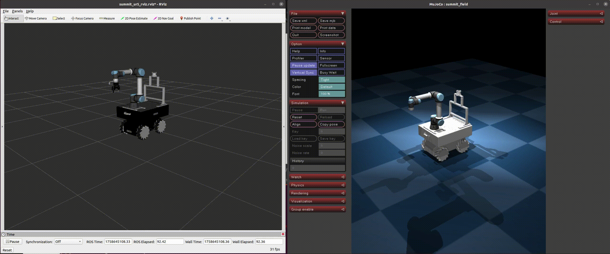

# SummitUR Whole-body Controller
This repository contains a whole-body controller for a Summit XLs mobile base with a UR5e manipulator, validated in the MuJoCo simulator.

## Overview

This project implements an optimal controller for a mobile manipulator using the Hierarchical Quadratic Programming (HQP) framework.

## Prerequisites
Before you begin, ensure you have the following dependencies installed:

1. **ROS 2 Humble**: Please follow the official installation instructions.
2. **pinocchio** : ```bash
roscore
roslaunch my_pkg demo.launch```
