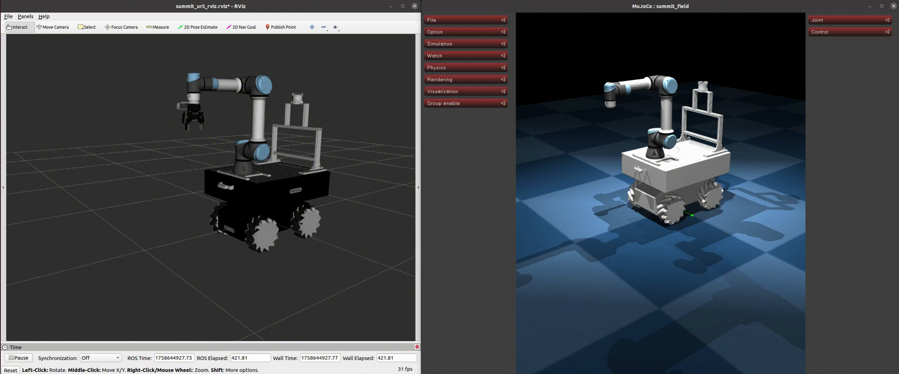

# SummitUR Whole-body Controller
This repository contains a whole-body controller for a Summit XLs mobile base with a UR5e manipulator, validated in the MuJoCo simulator.

## Overview

This project implements an optimal controller for a mobile manipulator using the Hierarchical Quadratic Programming (HQP) framework. Several constraints like self-collision avoidance are inserted Hierarchically

## Prerequisites
Before you begin, ensure you have the following dependencies installed:

1. **ROS 1 Noetic**: Please follow the official installation instructions.
2. **pinocchio** :
   For details, See the [official documents](https://github.com/stack-of-tasks/pinocchio).
   
     ```bash
     sudo apt install ros-noetic-pinocchio
     ```
3. **eiquadprog** :
      For details, See the [official documents](https://github.com/stack-of-tasks/eiquadprog).
   
     ```bash
     sudo apt install ros-noetic-eiquadprog
     ```
4. **MUJOCO** :
     ```bash
     pip install mujoco
     ```
5. **FCL** : Please follow the [official installation instructions](https://github.com/flexible-collision-library/fcl).

## Installation
1. **Clone the Repository**: Create a ROS workspace and clone this repository.

   ```bash
   mkdir -p ~/catkin_ws/src && cd ~/catkin_ws/src
   git clone https://github.com/cold-deuu/summit_ur5_project.git
   ```
3. **Build the Workspace**: Install dependencies and build the packages.
4. 
   ```bash
   cd ~/catkin_ws
   catkin_make
   ```
5. **Source the Environment**: Source the workspace's setup file to make the packages available in your environment.

   ```bash
   echo "source ~/catkin_ws/devel/setup.bash" >> ~/.bashrc
   source ~/.bashrc
   ```

## Usage
Follow these steps to launch the simulation and control the robot. Each command should be run in a new terminal.

1. **Launch Simulator** : This command launches the MuJoCo simulator with the robot controller.  
   - If `whole_body` is set to `true`, both the mobile base and the manipulator are controlled.  
   - If `whole_body` is set to `false`, only the manipulator is controlled.
   - 
   ```bash
   roslaunch rci_action_manager robot_mujoco.launch whole_body:=true
   ```
2. **Run the Action Client** : The client sends high-level commands with the target position of the robot.

   ```bash
   roscd rci_action_manager/scripts && python3 mm_client.py
   ```

## Experiments
---

### SE3 Tracking


### Joint Posture Tracking


### Joint Posuter with Self-Collision Avoidance


## To Do List
- [ ] Integrate Admittance Controller (see ros-noetic devel)
- [ ] Clear SCA Package
- [ ] Update How to Use the SCA Package

